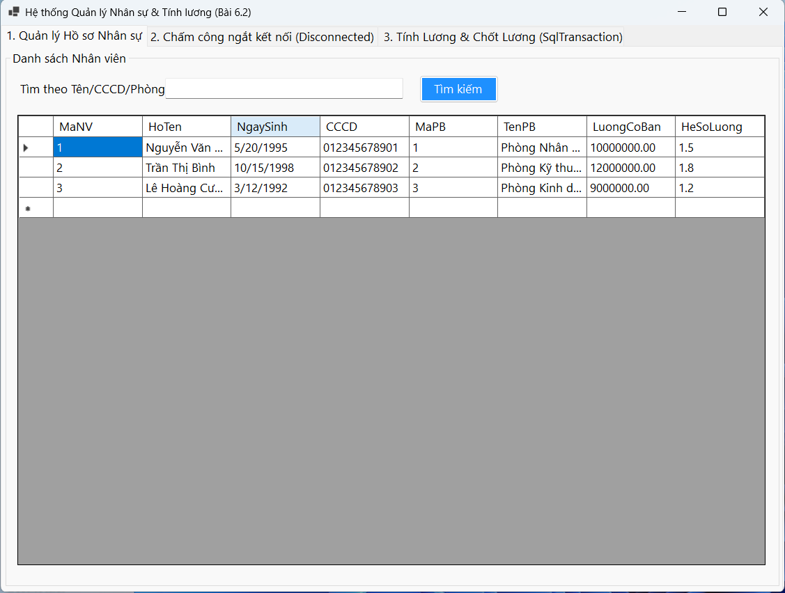
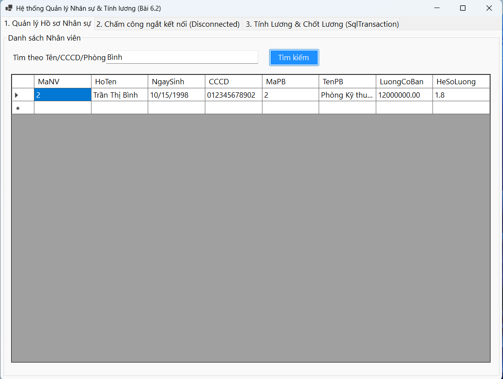
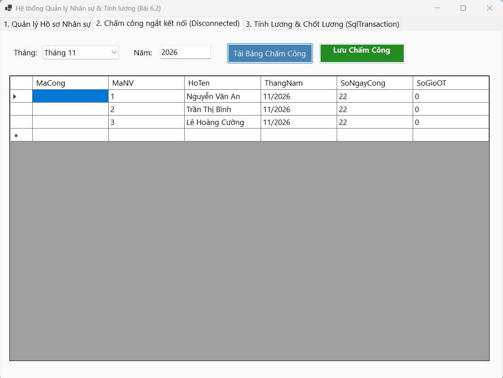
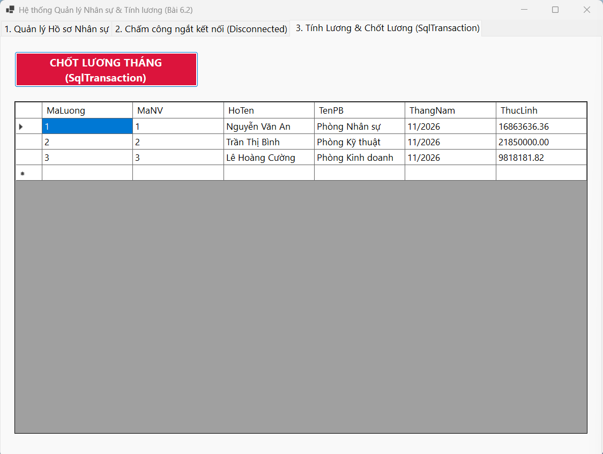
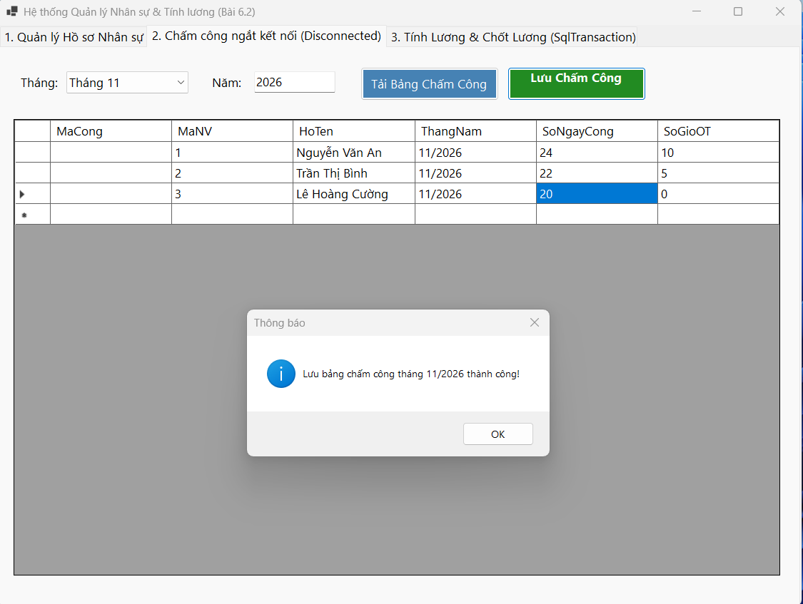

# BÁO CÁO BÀI TẬP THỰC HÀNH TỔNG HỢP (BÀI 6)
**Hệ thống Quản lý Bán hàng & Quản lý Nhân sự - Tính lương**

---

## MỤC 1: THÔNG TIN SINH VIÊN
* **Họ và tên sinh viên:** Nguyễn Vũ Nhật Minh
* **Mã sinh viên:** 24810320314
* **Lớp:** D19QTANM1

---

## MỤC 2: HÌNH ẢNH KẾT QUẢ CÁC MÀN HÌNH CHỨC NĂNG

### A. BÀI 6.1: HỆ THỐNG QUẢN LÝ BÁN HÀNG LẺ (RETAIL SALES SYSTEM)
1. **Màn hình Chính / Tổng quan hệ thống:**  
   

2. **Màn hình Quản lý Danh mục (CRUD - Thêm/Sửa/Xóa):**  
   

3. **Màn hình Thực thi Nghiệp vụ chính (Lập Hóa đơn / Bán hàng):**  
   

4. **Màn hình Báo cáo - Thống kê (ExecuteScalar / Lịch sử giao dịch):**  
   

5. **Minh họa An toàn Dữ liệu (Phòng chống SQL Injection / Báo lỗi Transaction Rollback):**  
   

---

### B. BÀI 6.2: HỆ THỐNG QUẢN LÝ NHÂN SỰ & TÍNH LƯƠNG (HRM & PAYROLL SYSTEM)
1. **Màn hình Chính / Tổng quan hệ thống:**  
   

2. **Màn hình Quản lý Danh mục (CRUD & Tìm kiếm Nhân viên):**  
   

3. **Màn hình Thực thi Nghiệp vụ chính (Chấm công ngắt kết nối Disconnected / Chốt lương SqlTransaction):**  
   

4. **Màn hình Báo cáo - Thống kê & Chốt lương tháng:**  
   

5. **Minh họa An toàn Dữ liệu (Đồng bộ SqlDataAdapter & Xử lý Transaction Chốt lương):**  
   